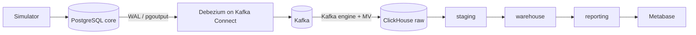

# Paymentyar Data Platform

An analytical platform for a simulated payment company: **PostgreSQL** (OLTP) → **Debezium + Kafka** (CDC) → **ClickHouse + dbt** (layered model) → **Metabase**.
The five dashboard cards now run **36–66× faster** and no longer touch the operational database.

## 1. Execution instructions

Requirements: Docker with Compose v2 and about 11 GB of free RAM. On Windows, use Docker Desktop with WSL2 and give WSL at least 12 GB (`%UserProfile%\.wslconfig` → `memory=12GB`).

```bash
docker compose up -d --build
```

The platform is ready after about 10 minutes: seeding takes ~3 min, the CDC snapshot ~5 min, and the first dbt run ~2 min. The one-shot containers `connect-init` and `metabase-setup` finish with exit code 0.

| Task | Command |
| --- | --- |
| Open Metabase | http://localhost:3000 (`admin@paymentyar.local` / `Paymentyar123!`) |
| Run all data tests | `docker compose exec dbt dbt test` (or `make test`) |
| Benchmark the cards | `make benchmark` — pauses the simulator, times and compares every card, writes `docs/benchmark.md` |
| Check CDC status | `curl localhost:8083/connectors/paymentyar-core/status` |
| Start from scratch | `docker compose down -v` |

## 2. Data generation and change simulation

**Initial data** (`source/init/02_seed.sql`) is generated inside PostgreSQL with `generate_series` and a fixed seed, so it is reproducible and loads in minutes:

- 2,000 merchants across 10 MCCs and 31 provinces (skewed toward Tehran), with risk levels LOW 70% / MEDIUM 22% / HIGH 8%.
- 5,000,000 transactions over the last 180 days: POS 60% / IPG 30% / QR 10%, and SUCCESS 80% / FAILED 10% / REVERSED 10%. Amounts range from 10k to 50M IRR (log-uniform); the fee is 0.2% with a 1,000 IRR minimum.

**Change simulator** (`simulator/simulator.py`) is a Python process with a 1-second loop:

- inserts 20 `PENDING` transactions per second; after 2–8 s they become `SUCCESS` (89%) or `FAILED`, and 11% of successes become `REVERSED` 15–60 s later;
- changes one merchant's `risk_level` and `province` every minute;
- inserts a test transaction (BIN `999999`) every 30 s and hard-deletes it 5–15 s later;
- runs `ALTER TABLE core.transactions ADD COLUMN installments` after 10 minutes (`SCHEMA_CHANGE_AFTER_SECONDS`).

## 3. Architecture and technology choices



| Need | Choice | Main reason | Rejected |
| --- | --- | --- | --- |
| CDC | Debezium 2.7 | Snapshot + streaming, deletes, per-key ordering, schema changes | `updated_at` polling (misses hard deletes), Airbyte (heavy) |
| Transport | Kafka 3.7 (KRaft, 1 node) | Durable, replayable buffer | Debezium Server (no ClickHouse sink) |
| Analytics DB | ClickHouse 24.8 | Columnar, native Kafka ingestion, ms-level aggregates | 2nd PostgreSQL (slow at scale), DuckDB (single writer) |
| Transformations | dbt + dbt-clickhouse | Versioned SQL, incremental models, tests, docs | Hand-written SQL scripts |
| Scheduling | Loop in the dbt container (60 s) | No extra service needed | Airflow / Dagster (2–4 GB RAM) |

Details, including how each CDC requirement is met: [docs/architecture.md](docs/architecture.md).

## 4. Data layer rules

| Layer | Allowed | Not allowed |
| --- | --- | --- |
| `raw` | Append CDC events as delivered | Updates, deletes, logic, BI access |
| `staging` | Typing, JSON parsing, PII hashing/masking | Joins, aggregation, dropping events |
| `warehouse` | Current state, SCD2 history, facts/dims | Clear-text PII, report-specific filters |
| `reporting` | Dashboard aggregates, business definitions | Any PII, row-level transactions |

Full rules: [docs/data_layers.md](docs/data_layers.md).

## 5. Analytical model

| Table | Grain (one row per…) |
| --- | --- |
| `warehouse.fct_transactions` | transaction (current state) |
| `warehouse.dim_merchant_scd2` | merchant version (`valid_from`, `valid_to`) |
| `warehouse.dim_merchant` | merchant (current state) |
| `reporting.rpt_daily_channel_status` | Tehran day × channel × status |
| `reporting.rpt_daily_merchant_sales` | Tehran day × merchant × risk level at txn × province at txn (SUCCESS only) |

Point-in-time attributes come from an `ASOF JOIN` of transactions to merchant versions. ER diagram and design rationale: [docs/data_model.md](docs/data_model.md).

## 6. Metabase performance comparison

Median of 5 warm runs through the Metabase API, cache bypassed, simulator paused. Measured on Windows, 16 GB RAM, Docker Desktop (WSL2). Raw output: [docs/benchmark.md](docs/benchmark.md).

| Card | Before (`core`) | After (`reporting`) | Speed-up | Results | Optimization |
| --- | ---: | ---: | ---: | --- | --- |
| 1. Daily success, 90 d | 3,683 ms | 67 ms | 55× | identical | Reads ~270 pre-aggregated rows instead of scanning 5M |
| 2. Success rate by channel, 30 d | 3,475 ms | 71 ms | 49× | identical | Same daily channel × status mart |
| 3. Top 10 merchants, month | 2,734 ms | 64 ms | 42× | identical | Merchant-day mart, no join at query time |
| 4. Fee by MCC × province, 90 d | 3,197 ms | 90 ms | 36× | 75 cells differ | Province at txn time precomputed |
| 5. Monthly volume by risk | 4,220 ms | 64 ms | 66× | differs by design | Risk at txn time precomputed |

All five cards no longer touch the OLTP database. Storage is columnar and sorted by `txn_date`, and aggregation happens once per dbt run instead of on every dashboard load.
**Card 4** differs only where a merchant's province changed: the original groups all history under the *current* province, while the new card uses the province at transaction time. **Card 5** now shows the risk level at transaction time, as required.

## 7. Assumptions and limitations

**Assumptions**

- Days are Tehran days (`Asia/Tehran`); months are Gregorian, not Jalali.
- Amount, fee and volume metrics count only `SUCCESS`; success rate = SUCCESS / all non-PENDING transactions; the top 10 is ranked by successful amount.
- Merchant history before CDC started is unknown, so the snapshot state is treated as valid since the beginning.
- Test transactions are identified by BIN `999999`.

**Limitations / not implemented**

- Single-node Kafka and ClickHouse (replication factor 1); Metabase uses H2; internal passwords are hard-coded for local use.
- A dbt loop instead of an orchestrator; end-to-end latency is about 1–2 minutes.
- A forced Debezium re-snapshot would reset merchant history; production needs a guard.
- No dead-letter queue for malformed messages and no alerting on failed tests.
- The PII hash salt is an environment variable, not a secret store.