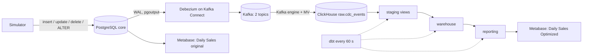

# Architecture

## Overview

1. The **simulator** writes changes to PostgreSQL `core`.
2. **Debezium** reads the write-ahead log through a replication slot and a publication. It takes one consistent snapshot, then streams every insert, update and delete as a JSON event.
3. **Kafka** stores the events in one topic per table (`paymentyar.core.merchants`, `paymentyar.core.transactions`). The message key is the primary key, so all changes of a row stay in one partition, in order.
4. **ClickHouse** consumes both topics with its Kafka engine. A materialized view appends every event, unchanged, to `raw.cdc_events`.
5. **dbt** runs every 60 seconds and incrementally builds the staging, warehouse and reporting layers.
6. **Metabase** reads only the `reporting` database, using a user that has no access to other layers.

## Technology choices

| Component | Tool | Why | Rejected alternatives |
| --- | --- | --- | --- |
| Source | PostgreSQL 16 | Required; logical replication built in | — |
| Seed data | SQL `generate_series` | 5M rows in minutes, no extra tooling, reproducible with `setseed` | Python + Faker (much slower, more code) |
| Simulator | Python + psycopg 3 | Short, readable, easy to tune | Bash + psql (hard to keep state) |
| CDC | Debezium 2.7 on Kafka Connect | Industry standard; snapshot + streaming; captures hard deletes and schema changes | Polling `updated_at` (misses deletes and intermediate states), Airbyte (≈4 GB RAM, batch) |
| Broker | Kafka 3.7, single node, KRaft | Durable, replayable buffer that decouples source and target; no ZooKeeper | Redpanda (fine, less standard), Debezium Server (no ClickHouse sink) |
| Analytical store | ClickHouse 24.8 LTS | Columnar; reads Kafka natively; aggregates millions of rows in milliseconds | Second PostgreSQL (simpler, slow at scale), DuckDB (single writer, no streaming ingest) |
| Transformations | dbt-core + dbt-clickhouse | SQL in Git, lineage, incremental models, tests and docs in one tool | Hand-written SQL scripts (no tests or lineage), Spark (overkill) |
| Scheduling | Loop in the dbt container | One job does not justify an orchestrator | Airflow / Dagster (2–4 GB RAM, more moving parts) |
| BI | Metabase + official ClickHouse driver | Required | — |
| Packaging | Docker Compose | Single command, runs anywhere | Kubernetes (out of scope) |

**Message format.** JSON without embedded schemas. Messages are 3–4× smaller, and nothing downstream needs the schema because `raw` stores row images as JSON strings. Avro with a Schema Registry is the production choice, but it adds a service.

## How the CDC requirements (T1) are met

| Requirement | Mechanism |
| --- | --- |
| Initial snapshot + subsequent changes | `snapshot.mode=initial`: a consistent snapshot (`op=r`), then streaming from the replication slot (`c`, `u`, `d`) with no gap |
| Updates and deletes applied correctly | `REPLICA IDENTITY FULL` gives full before/after images. Warehouse tables use `ReplacingMergeTree(_version, _is_deleted)`, so the latest version wins and deleted rows disappear from the current state |
| Ordering preserved | Kafka key = primary key → per-row ordering within a partition. The WAL position `source.lsn` is stored and used as the version column |
| History of changes | `raw.cdc_events` is append-only and never updated: every version of every row, including deleted test transactions, is kept |
| `installments` column does not break the pipeline | Debezium emits the new field automatically. Raw stores row images as JSON strings, so raw needs no schema change. Staging reads the field as `Nullable(Int16)` (NULL for older events) |
| Duplicates (at-least-once delivery) | Warehouse tables deduplicate on (key, LSN), and incremental loads re-read a 1-minute window on purpose, so replays change nothing |

## Resource usage

| Service | Memory cap |
| --- | --- |
| source-db | 2 GB |
| kafka | 1 GB |
| connect | 1.5 GB |
| clickhouse | 3 GB |
| metabase | 2 GB |
| dbt | 1 GB |
| simulator | 256 MB |
| **Total** | **≈ 11 GB** (fits the 16 GB limit) |

End-to-end latency from a change in PostgreSQL to the reporting tables is about 1–2 minutes: a few seconds for CDC, plus up to 60 seconds waiting for the next dbt cycle, plus the run itself.