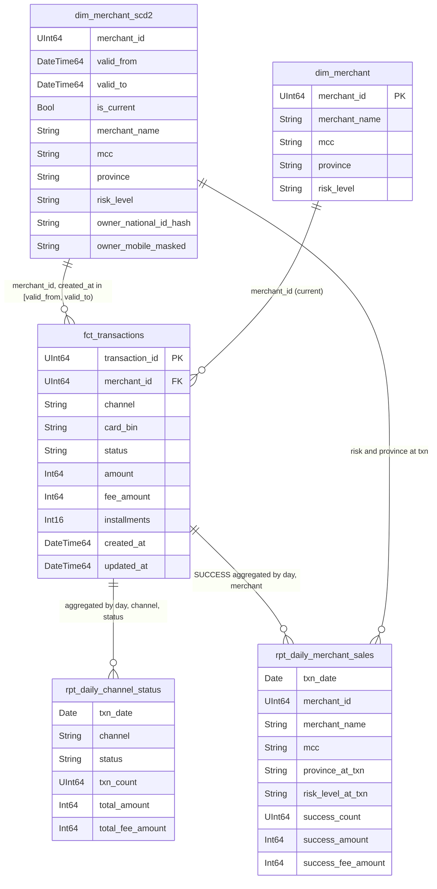

# Analytical model

A small star schema: one transaction fact, a merchant dimension with full history (SCD Type 2), and two aggregated reporting tables that serve the five dashboard cards.

## Diagram



## Tables, grain and design decisions

| Table | Layer | Grain (one row per…) | Storage | Why |
| --- | --- | --- | --- | --- |
| `stg_core__merchants`, `stg_core__transactions` | staging | change event | view over raw | Typing and PII masking in one place, with no data copy |
| `int_transactions` | warehouse | transaction version (collapses to the latest) | `ReplacingMergeTree(_version, _is_deleted)`, ordered by (day, id), partitioned by month | Append-only incremental loads; ClickHouse keeps the latest version and drops deleted rows |
| `int_merchant_versions` | warehouse | merchant × `valid_from` | `ReplacingMergeTree(_version)` | One row per merchant change; the basis for point-in-time joins |
| `fct_transactions` | warehouse | transaction, current state | view (`FINAL`, not deleted) | One clean entry point for analysts and tests |
| `dim_merchant_scd2` | warehouse | merchant version | view adding `valid_to` / `is_current` | Classic SCD2 shape for analysis |
| `dim_merchant` | warehouse | merchant, current state | view | Current attributes when history is not needed |
| `rpt_daily_channel_status` | reporting | Tehran day × channel × status | MergeTree, incremental by day | Cards 1 and 2 read ~300–400 rows instead of millions |
| `rpt_daily_merchant_sales` | reporting | Tehran day × merchant × risk at txn × province at txn (SUCCESS only) | MergeTree, incremental by day | Cards 3, 4 and 5 with no join at query time |

## Point-in-time attributes (risk level and province)

Every merchant change event becomes a row in `int_merchant_versions`, with `valid_from` set to the PostgreSQL commit time. Reporting joins each transaction to the merchant version that was valid when the transaction was created, using ClickHouse's `ASOF JOIN`:

```sql
ASOF LEFT JOIN merchant_versions m
  ON t.merchant_id = m.merchant_id AND t.created_at >= m.valid_from
```

The `ASOF JOIN` picks the latest version with `valid_from <= created_at`. Snapshot rows get `valid_from = 1970-01-01`, because no history exists from before CDC started.

## Incremental processing

- **Warehouse:** each run appends only events with `ingested_at` greater than the last loaded value minus 1 minute. Re-read events have the same version and collapse, so runs are idempotent.
- **Reporting:** a transaction can change status hours after it is created, which changes past daily totals. Each run finds the days touched by new transaction versions (or by late merchant changes) and rebuilds only those days. Normal runs touch 1–2 of ~180 days.
- `dbt run --full-refresh` rebuilds everything; it is a recovery tool, not the normal path.

## Why two reporting tables instead of one

A single table at merchant × channel × status × day grain would have about as many rows as the fact table itself, so no gain. Splitting by what the cards need keeps both tables small: about 1,600 rows for the channel table and a few hundred thousand for the merchant table.